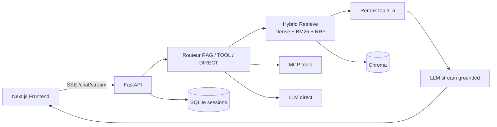

# Enterprise Copilot

Assistant documentaire professionnel : **RAG hybride** (dense + BM25 + RRF + rerank), **stream SSE** (raisonnement + tokens + sources), sessions avec mémoire, déploiement **Azure AKS / Argo CD**.

## Démo rapide

1. Ouvrir le frontend (local ou Ingress Azure)
2. Indexer un PDF (onglet Documents)
3. Poser une question → panneau **Raisonnement** à droite → réponse streamée → **source** (fichier + pages)

> Ajoutez un GIF / vidéo 30 s ici (`docs/demo.gif`) pour LinkedIn / README.

## Architecture



**Flux** : Next.js → FastAPI → routeur agent → retrieval hybride → rerank → génération ancrée (citations fichier / page) → SSE.

## Installation locale (3 commandes)

```bash
cp .env.example .env   # renseigner OPENROUTER_API_KEY
docker compose up --build
# API: http://127.0.0.1:8000
```

Sans Docker :

```bash
pip install -r requirements.txt
uvicorn main:app --host 0.0.0.0 --port 8000
cd frontend && npm i && npm run dev
```

Frontend : définir `NEXT_PUBLIC_API_URL` (ex. `http://127.0.0.1:8000`).

## Piliers techniques

| Pilier | Implémentation |
|--------|----------------|
| Recherche hybride | Dense (Chroma) + BM25 + **RRF** + rerank (cross-encoder si dispo) |
| Réponses ancrées | Prompt strict + citations fichier/page + sources filtrées |
| Observabilité | Spans latence (`src/observability/tracing.py`) — brancher LangSmith via env |
| Résilience | Pydantic v2, erreurs SSE gracieuses, toasts UI |

`USE_CROSS_ENCODER=0` pour désactiver le cross-encoder (fallback lexical).

## Azure / GitOps

- Terraform : `terraform/`
- Ansible bootstrap : `ansible/` (via Docker)
- Kustomize Azure : `k8s/overlays/azure`
- CI : `.github/workflows/ci-cd.yaml` (build ACR + bump tags Argo)

Voir [docs/AZURE_DEPLOY.md](docs/AZURE_DEPLOY.md) et [docs/FULL_AUTOMATION.md](docs/FULL_AUTOMATION.md).

## API utiles

| Endpoint | Rôle |
|----------|------|
| `POST /chat/stream` | SSE : reasoning, route, sources, tokens, done |
| `POST /sessions` | Nouvelle conversation |
| `GET /sessions` | Historique |
| `POST /upload` | Indexation document |

## Structure

```
app.py / streaming_chat.py / rag.py   # API live + RAG hybride
frontend/                             # Next.js UI
k8s/ terraform/ ansible/              # GitOps & IaC
src/retrieval src/lexical src/rerank  # modules RAG
```
